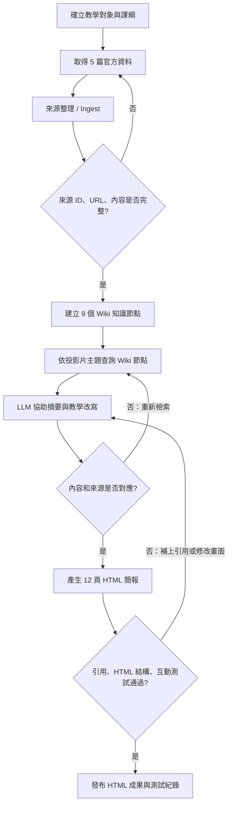

# AI Agents LLM Wiki → HTML 教學簡報：Workflow / Graph

作業日期：2026-11-23

## 1. 主題與規劃（先討論，後生成）

**主題**：AI Agents：從 LLM、Tool Use 到 Workflow Graph。

製作前先明確定義教學設計問題：受眾為沒有 Agent 背景的大學生；預期學完能分辨 LLM、Workflow、Agent，理解 Tool Use 與 Loop，並知道為什麼要用來源驗證。

**先規劃的教學大綱**：定義與例子 → 元件 → Agent Loop → Wiki 檢索 → Graph → 讀書規劃案例 → 驗證 → 小測驗／重點整理。確定課綱後，再由 LLM 協助將官方文件重點轉成自己的中文知識節點與簡報文字；不把網站原文整段貼入簡報。

## 2. 5 篇資料的取得與 ingest

從官方文件選取五篇，檢查主題是否與 Agent 設計有關，先寫出引用來源及每篇的三項事實要點；再整理為 `sources/S01.md` ～ `sources/S05.md`。

| 編號 | 機構 | 文件 | 取得的知識 |
|---|---|---|---|
| S01 | OpenAI | A practical guide to building agents | Model、Tools、Instructions、來源／行動工具 |
| S02 | Anthropic | Building effective agents | Workflow 和 Agent 區別、評估與優化 |
| S03 | LangChain | Agents documentation | Model–Tool–Observation Loop |
| S04 | Google ADK | Agents | Sequential、Parallel、Loop、Graph |
| S05 | Microsoft Learn | Agent Framework overview | 何時使用 Agent 或 Workflow，Graph 編排 |

來源 URL、核對說明與 SHA-256 記錄在 `data/source_manifest.json`。本作業 ingest 的是**以官方頁面為依據的五份整理筆記**，不是把網頁全文無條件自動抓取。`scripts/build.py` 會實際讀取五份筆記、驗證來源 ID 和 URL、寫入 `data/knowledge_base.json`，並建立 Wiki 頁面。

## 3. Graph 流程圖

### 節點說明

1. **取得資料**：查閱官方文件、記錄標題與 URL，挑選真正與教學主題相關的內容。
2. **整理／Ingest**：將五篇來源摘要保存成獨立的本地 Markdown 筆記，產生來源索引與 SHA-256。
3. **查詢 Wiki**：依每張投影片的教學目標，對應到 C01～C09 知識節點與 S01～S05 原始來源。
4. **整理重點**：LLM 協助把術語改成中文入門說明、比較表、實際案例與小測驗。
5. **檢查內容**：在文字轉成 HTML **之前**，先檢查知識節點是否具有有效來源；產生 HTML 後，再自動驗證每頁的來源完整性。
6. **生成簡報**：利用 `scripts/build.py` 從知識節點映射產生離線可瀏覽的 `slides.html`，同時提供可搜尋的 `wiki.html`。

### 哪些地方會重複？

- **資料取得迴圈**：如果來源沒有對應到投影片想教的概念，就回到資料查詢／補充筆記。
- **生成前迴圈**：摘要有概念錯誤、來源不符或太難理解，就回到 Wiki 檢索與重寫。
- **生成後迴圈**：來源 ID 缺漏、HTML 結構不完整或互動失敗，就修正後再次執行驗證。

這樣設計，是因為把檢查只放在最後，會浪費時間重新排版，也可能留下無法追溯的陳述。越早檢查來源對應，越能讓簡報內容可信，且方便老師回查。

## 4. 一次實際執行與測試紀錄

**執行日期：2026-11-23。**

1. `python scripts/build.py --simulate-missing-citation`：產生測試用初稿，刻意讓第 10 頁漏附來源，用來驗證失敗路徑是否真的被攔截。這是**注入的測試案例**，不是自然發生的錯誤。
2. `python scripts/validate.py`：**93 PASS、2 FAIL**，第 10 頁觸發「未附來源 ID」與「來源對應不一致」兩項錯誤；詳細結果見 `tests/01_first_draft_failed.txt`。
3. `python scripts/build.py`：重新產生完整來源引用與頁腳連結。
4. `python scripts/validate.py`：**95 PASS、0 FAIL**；詳細結果見 `tests/03_final_validation.txt`。
5. 使用 Chromium 以瀏覽器載入實際 HTML 內容並測試：前後頁按鈕、End／方向鍵切頁、測驗顯示答案、Wiki 搜尋過濾及空結果提示，**7 PASS、0 FAIL**；見 `tests/04_browser_validation.txt` 及畫面截圖。

**最終檢查總覽**：5 篇來源筆記、9 個 Wiki 節點、12 頁簡報；所有簡報頁都有可回查 Wiki 的來源 ID。以上數字是本地測試結果，不代表已部署到外部網站。

## 5. 反思及修正

**哪個節點最容易出錯？** 「知識轉成簡報」階段最容易遺漏來源。初稿的故障注入顯示，一張投影片即使內容正確，若失去與 Wiki 的對應關係，仍無法滿足可追溯的要求。這次只做了有限的檢查，不主張已有統計上最常出錯的節點。

**檢查移到哪個步驟？** 原本只規劃在「HTML 產出之後」檢查；調整成在「Wiki 檢索 → 教學摘要」之間先驗證每個 Cxx 對應的 Sxx 來源，再於 HTML 生成後用程式檢查完整性。

**有沒有修改 Workflow／Graph？** 有。從單一末端檢查，改成前端來源檢查 + 末端可用性檢查的**雙層驗證 Graph**。來源錯誤退回檢索；互動／排版錯誤退回產生 HTML。驗證不通過則不能視為完成。

## 6. 實作界線

LLM 用於這次知識整理與教學文字設計；可重跑的 `build.py` 是**確定性生成器**，不是持續在線呼叫模型的自治 Agent。Wiki 是本地可搜尋的知識庫，不會自動抓網頁或連接聊天 API。這樣做的好處是無 API 金鑰也能重跑、可離線查看、驗證結果可重現。若要擴展成即時 RAG，可在 Wiki 查詢節點換成 embedding 搜尋並接 LLM API。
